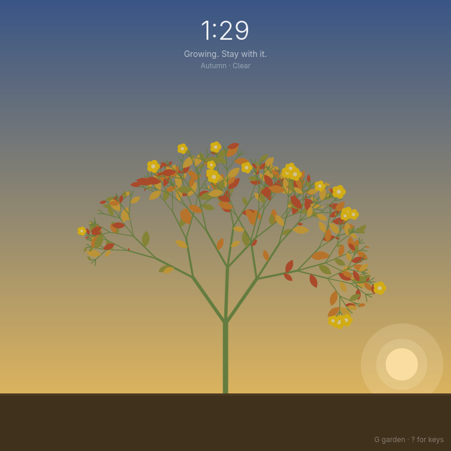
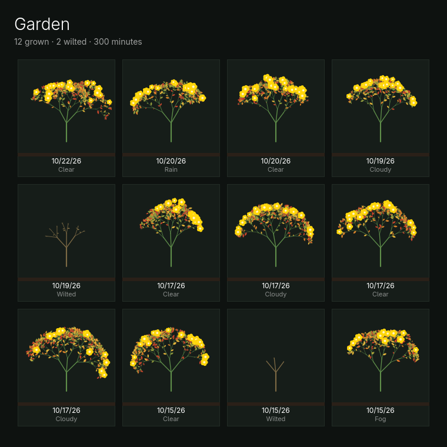

# Grove

A focus timer that grows a plant while you work. Press Space to plant a seed.
Stay with it for 25 minutes and the plant blooms; give up and it wilts. Either
way it stays in your garden.

- **Light follows the clock.** Dawn, noon, golden hour and night, with dusk
  warming toward your Omarchy accent. Day length follows the calendar for a
  mid-northern latitude. There is no location lookup.
- **Weather and seasons.** Each session rolls its own sky (clear, cloudy, rain
  or fog), weighted by the season, and it can change part-way through. Rain
  nudges growth along a little. Leaves are green, then autumn colours, then
  bare and frosted in winter. The weather is invented, never fetched.
- **Fog horns.** In fog a deep horn sounds now and then, with a quieter answer
  from farther out. It is synthesized at start-up, so nothing is shipped or
  downloaded. M mutes it.
- **A garden.** Every finished or wilted plant is kept, and G shows them all.

## Keys

| Key   | Action                   |
|-------|--------------------------|
| Space | Plant a seed, or give up |
| G     | Show or hide the garden  |
| M     | Mute or unmute fog horns |
| ?     | Show the keys            |
| Q     | Quit                     |

Giving up or quitting mid-session asks first, because the plant wilts.

## Install

On Arch or Omarchy: `bin/install` builds the package and installs it, and
Grove then appears in the launcher (Super + Space). To just run it:
`bin/build && build/grove`. `bin/test` runs the tests.

It needs `qt6-base`, `qt6-declarative`, `qt6-multimedia` and `qt6-wayland`.

## Languages

Grove follows the language chosen under Omarchy's Setup > Language, live.
Catalogs ship for Danish, German, Mexican Spanish, French, Brazilian
Portuguese and Japanese; anything else shows English. `bin/check-i18n` checks
that every catalog covers every string.

## Your data

Plants are kept in `~/.local/share/grove/garden.json`, written atomically. If
that file cannot be read, Grove leaves it exactly as it is, says so in the
window, and does not save over it.

## Trying things out

| Variable | Effect |
|----------|--------|
| `GROVE_SECONDS=30` | A short session. It is not saved to the garden unless `GROVE_GARDEN` is also set. |
| `GROVE_TIME=17:05` | Freeze the sky at that time. |
| `GROVE_DATE=2026-10-20` | Pin the date, and so the season. |
| `GROVE_WEATHER=fog` | Pin the weather: `clear`, `cloudy`, `rain` or `fog`. |
| `GROVE_GARDEN=/path/garden.json` | Use another garden file. |

## License

MIT. The build layout and theme and language watching follow Omacut and
Monologue by David Heinemeier Hansson, also MIT.
