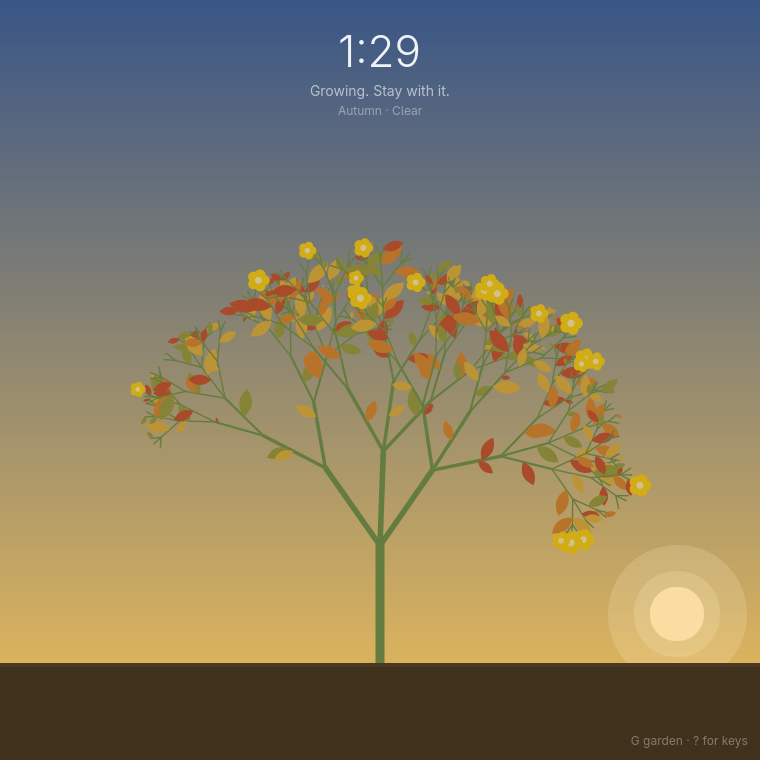

# Grove Rust Port Review

Grove 0.9.0 (C++) → 0.10.0 (Rust), November 2026

Grove is a focus timer for Omarchy that grows a plant in a mountain landscape
while you work. On 13 November 2026 its C++ code was rewritten in Rust, keeping
the Qt Quick window as it was. This page compares the two versions, lists what
we learned and what got in the way, and suggests how Rust could serve this kind
of program better.

> [!NOTE]
> This port was done as an experiment to learn about Rust. The Rust version of
> Grove should not be taken as a finished application.

The same review is also in [rust-port-review.html](rust-port-review.html),
for opening in a browser.

## The two versions

| | C++ 0.9.0 | Rust 0.10.0 |
|---|---|---|
| Hand-written code, excluding QML | 4,565 lines (3,487 app + 1,078 tests) | 10,664 lines (5,160 app logic + 4,700 Qt connection code + 757 scene tests) |
| QML | 1,818 lines | Same files, two small edits |
| Libraries | Qt only: sound, D-Bus, file watching and sockets all from Qt | Qt plus 170 crates (zbus, rodio and cpal, notify, serde_json, chrono, fastrand) |
| Program size, stripped | 0.43 MB | 5.1 MB, about 12 times larger |
| Package | 189 KB | 1.7 MB |
| Release build | Quick | About 3 minutes |
| Tests | Unit and scene tests | 133 unit and 12 scene tests, a Valgrind leak check and a soak test |
| `unsafe` | Not applicable | 74 uses, all in the Qt connection code under `src/qml/` |

Rust keeps its unit tests in the same files as the code, so the app logic
count includes them. The C++ count keeps its tests separate.

The landscape came out identical. The hills, field and track bed matched the
C++ drawings pixel for pixel (0 differing pixels across 11 pictures).
Whole-window frames differed by no more than the C++ build differs from itself
between runs.

## What we learned

1. **The real gain came from separating the logic from Qt.** Session, weather,
   light, garden, sounds and theme parsing are now plain Rust with no Qt in
   them, so they can be tested with `cargo test` alone. `App::advance` returns
   events and runs no timers, which makes timing testable. We could have done
   this in C++, but the port forced it.
2. **Rust kept memory errors out of the logic, but most of our bugs weren't
   memory errors.** Two rounds of independent review found logic and
   Qt-behavior bugs:
   - the file watcher woke itself up by reading the files it watches, so the
     app reloaded endlessly and kept starting hyprctl
   - QML singletons weren't actually created
   - building a new `QQmlExpression` on every call leaked about 66 KB per round

   Rust doesn't count leaks as unsafe, so we still needed Valgrind and the
   soak test.
3. **The risky code is still at the edge, now marked `unsafe`.** Object
   ownership, threads, the scene graph and Qt calling back into our code are
   where a Qt app actually breaks. That's exactly where all 74 `unsafe` uses
   are.
4. **Replacing Qt modules with crates means relearning each one's quirks.**
   Qt's D-Bus, audio and file-watching pieces were designed to work together.
   Their crate replacements each needed their own fixes:
   - zbus is async-only and has no default timeout, so we added one (25 s)
   - cpal reports harmless errors through the same path as fatal ones
   - notify reports file opens, which caused the self-wake bug above

   In exchange we dropped the qt6-multimedia dependency, and `cargo audit` plus
   Dependabot now cover 170 crates.
5. **The port fixed one old bug.** The C++ session clock ran about 1% long;
   the Rust one doesn't.

## Limitations we ran into

- **Gaps in cxx-qt-lib.** cxx-qt-lib is the crate that provides ready-made Qt
  types for Rust. It has no `tr()` or translate, no QIcon (so the X11 window
  icon was dropped), no `QPainterPath::moveTo`, no fractional-width QPen and
  no `QLocale::setDefault`. That last gap forced the QML change to
  `Qt.locale(Translator.locale)`. QTest isn't covered either.
- **Qt's C++ class structure doesn't translate.** Nested types like
  `QQuickItem::Flag` and `UpdatePaintNodeData` can't be declared normally and
  needed hand-written `ExternType` code. Calling static methods needed a
  workaround type. Generated names (`<type>$<fn>`) clash, which forced `q_`
  name prefixes. Creating Qt objects goes through cxx-qt-lib's internal
  `rust::cxxqtlib1::make_unique`.
- **Mistakes in the setup fail late.** A connection file missing from
  `build.rs` only shows up at runtime as "X is not defined" in QML. A QML
  singleton isn't created until something reads it, hence `start_services`.
- **The package now breaks on Qt upgrades.** cxx-qt-build can't pass
  `--only-bytecode` to qmlcachegen, so the program uses three private Qt
  functions. It has to be rebuilt after every Qt upgrade, which is why the
  package ships a pacman hook that reminds you.
- **No link-time optimization.** Rust's linker can't link the GCC LTO output
  from the generated C++, so the PKGBUILD has `!lto`.
- **"No C++" only covers code we write.** cxx-qt still generates C++, so a C++
  compiler is still required to build.
- **The tools cost more.** The program is 12 times bigger and builds slowly.
  Memory-error checkers (sanitizers) need nightly Rust, so Valgrind does that
  job. Also, rustfmt breaks long chains even with `max_width` set to 120.
- **Small behavior change.** Random weather now comes from fastrand, so a
  given seed produces different weather than in C++. Saved plants aren't
  affected.

## How Rust could work better for this kind of app

This kind of app is a thin layer of logic under a large C++ UI framework.

- **Calling C++ directly.** Most of the extra code exists because Rust can't
  directly use C++ classes, inheritance, virtual methods, nested types or
  templates. The Rust Foundation's C++ interop work and tools like Crubit aim
  at this. Being able to subclass and override C++ methods directly would
  remove most of `src/qml/`.
- **Objects that call back into themselves.** Qt signals often call back into
  an object that's already in use. Rust's borrowing rules don't allow that, so
  cxx-qt uses `Pin<&mut>`, and we used queued signals and model snapshots. The
  "pin ergonomics" work in progress would ease some of this.
- **Sanitizers on stable Rust.** Leak and thread checks then wouldn't depend
  on Valgrind.
- **Shared Rust libraries for distributions.** Rust has no stable ABI, so
  every app ships its own copy of zbus, cpal and the rest. That accounts for
  most of the 12 times larger program. The crABI proposal would help here.
- **Async that fits into an existing event loop.** zbus brings its own runtime
  alongside Qt's event loop. A standard way to run Rust async code on a GUI's
  event loop would remove our D-Bus thread.
- **In the tools around Rust.** Wider cxx-qt-lib coverage and a qmlcachegen
  bytecode-only option would fix the icon, translation and Qt-upgrade
  problems.

## Bottom line

The logic layer was the payoff: it's testable, has no `unsafe`, and caught the
clock bug. The Qt connection code cost us the most: more than twice the lines,
a program 12 times bigger, a rebuild after every Qt upgrade, and a lot of
hand-written binding code.

For the next round of work this matters mainly when we use a Qt API we haven't
connected yet. QML changes and new drawing in the existing layers won't run
into it.

---

Compared: the C++ source at tag `cpp-0.9.0` (commit 1c40ab5) and the Rust code
merged to dev in PR #7 (commit 4ae3bbb). Line counts exclude QML, build scripts
and generated code.
